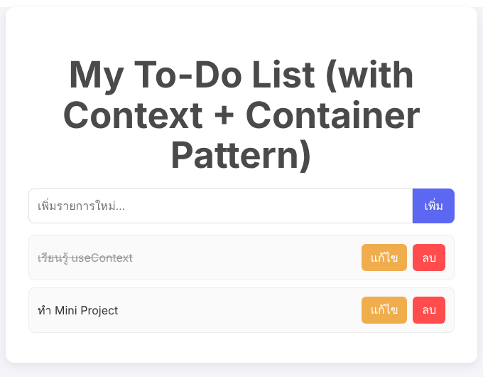
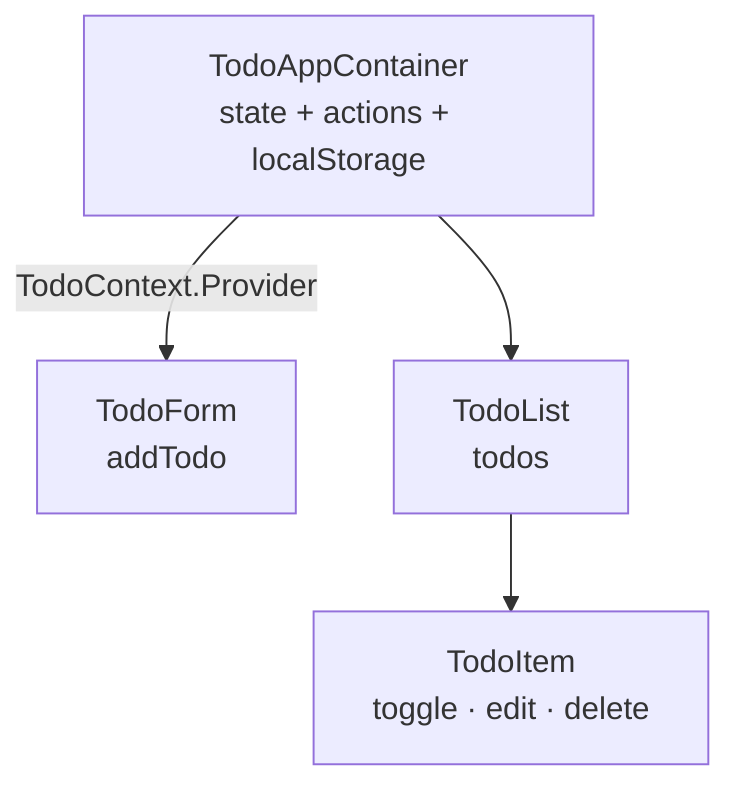

# To-Do List — Context API + Container Pattern

**A to-do app that separates logic from presentation: one container component owns the state and shares actions through React Context, while small presentational components just render and call them.**


> **ENGSE203, Lab 3.1: React state, Context and component patterns.**



## Design



- **Container/presentational split:** only `TodoAppContainer` knows how todos are stored and updated
- **Context instead of prop drilling:** each component pulls just the actions it needs with `useContext`
- **Immutable updates** with functional `setState`
- **Inline editing:** click *Edit*, then save with Enter or by clicking away; empty edits are ignored
- **Persistence:** todos are saved to `localStorage` and restored on reload

## Run

```bash
git clone https://github.com/tawan230666/React-To-Do-List-lab3-1.1.git
cd React-To-Do-List-lab3-1.1
npm install
npm run dev
```

---

**Author:** Tawan Tiphkun (ธาวัน ทิพคุณ), [@tawan230666](https://github.com/tawan230666), Software Engineering, RMUTL Chiang Mai
